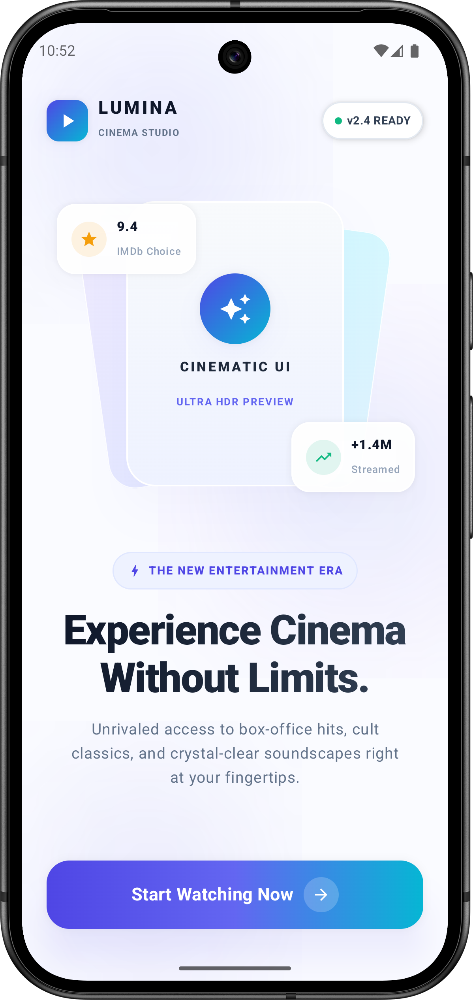
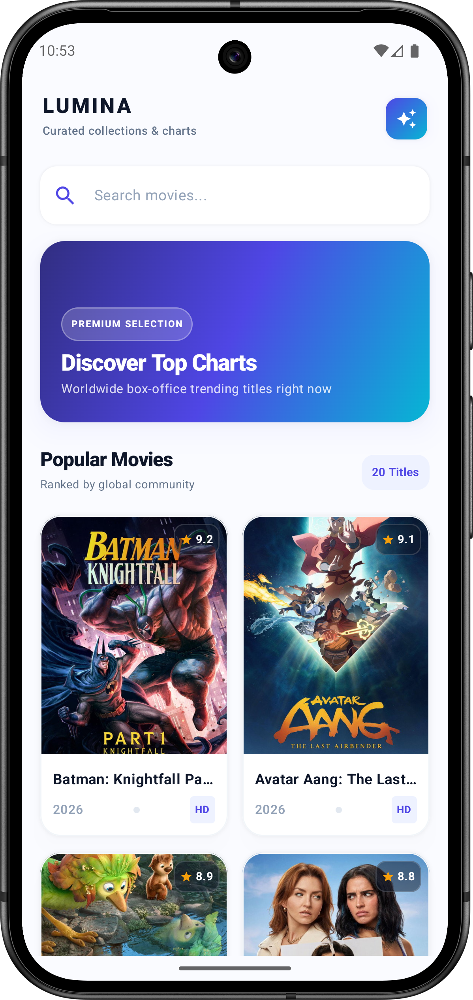
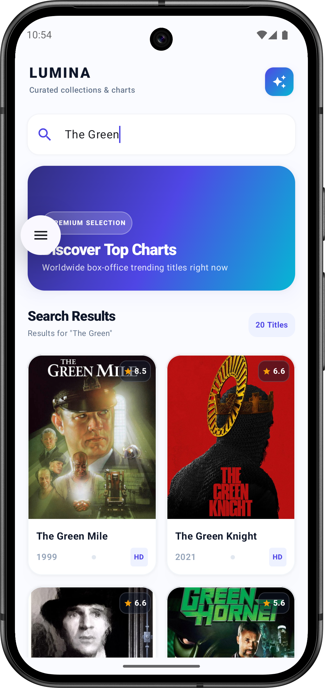
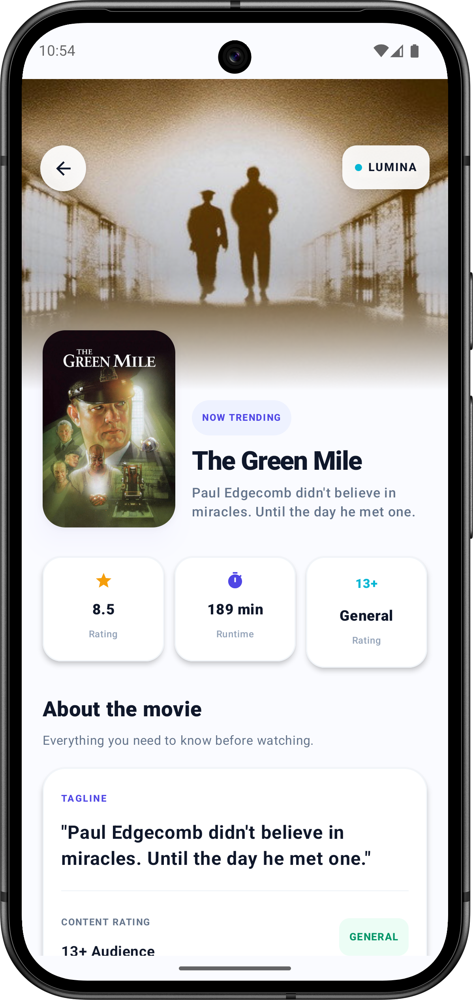

# 🎬 Lumina Movie App

A modern Android movie discovery app built with **Kotlin** and **Jetpack Compose**, powered by the **TMDB API**.

Lumina lets users browse popular movies, search for titles, explore movie details, and visit official movie websites through a clean and modern interface.

---

## 🏗 Clean Architecture

Lumina follows **Clean Architecture** with **MVVM**, keeping the UI, business logic, and data layers separated.

```text
Jetpack Compose UI
        ↓
ViewModel
        ↓
Use Case
        ↓
Repository Interface
        ↓
Repository Implementation
        ↓
Retrofit API
        ↓
TMDB
```

API responses are received as **DTOs**, mapped into **Domain Models**, and exposed to the UI through **StateFlow-based UI state**.

---

## ✨ Features

- Browse popular movies
- Search movies
- View detailed movie information
- Ratings, release dates, posters and backdrops
- Open official movie websites
- Pull-to-refresh
- Loading and error handling
- Type-safe navigation
- Modern Jetpack Compose UI

---

## 🛠 Tech Stack

- **Kotlin**
- **Jetpack Compose**
- **Clean Architecture**
- **MVVM**
- **Koin**
- **Retrofit**
- **OkHttp**
- **Gson**
- **Kotlin Coroutines**
- **StateFlow**
- **Navigation Compose**
- **Kotlin Serialization**
- **Coil**
- **TMDB API**

---

## 📂 Project Structure

```text
com.example.cleanmovieapp
│
├── data
│   ├── remote
│   │   ├── dto
│   │   │   ├── MovieDetailDto
│   │   │   └── MoviesDto
│   │   └── MovieAPI
│   │
│   └── repository
│       └── MovieRepositoryImpl
│
├── di
│   ├── module
│   └── MyApplication
│
├── domain
│   ├── model
│   │   ├── Movie
│   │   └── MovieDetail
│   │
│   ├── repository
│   │   └── MovieRepository
│   │
│   └── use_case
│       ├── GetMoviesUseCase
│       ├── GetMovieDetailUseCase
│       └── GetMovieSearchUseCase
│
├── presentation
│   ├── movie_detail
│   │   ├── viewmodel
│   │   └── views
│   │
│   ├── movies
│   │   ├── components
│   │   │   ├── FeaturedBanner
│   │   │   └── MovieCard
│   │   ├── viewmodel
│   │   └── views
│   │
│   ├── navigation
│   │   └── AppRoute
│   │
│   ├── ui
│   └── welcome
│       └── views
│
├── util
│   ├── Constants
│   └── Resource
│
└── MainActivity
```

---

## 🔑 API Configuration

Lumina uses the **TMDB API** for movie data.

Add your TMDB access token to the project's `local.properties` file:

```properties
TMDB_ACCESS_TOKEN=YOUR_TMDB_ACCESS_TOKEN
```

The token is excluded from version control through `.gitignore`.

---


## 📱 Screenshots

<p align="center">
  
  
</p>

<p align="center">
  
  
</p>